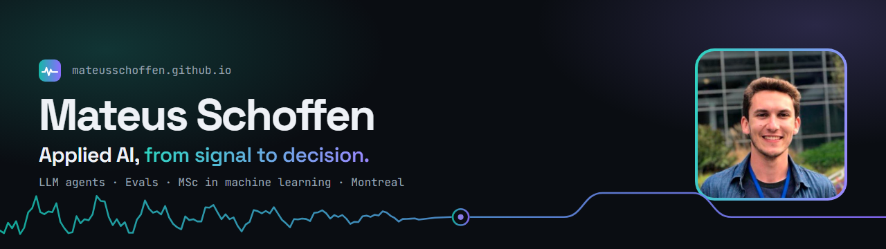

### Hi, I'm Mateus 👋

**Applied AI specialist in Montreal.** I build LLM agents and AI automations that run real business workflows,
backed by 14 years in IT, R&D project leadership and university teaching.

🌐 **Portfolio:** [mateusschoffen.github.io](https://mateusschoffen.github.io/) · 📄 [Résumé](https://mateusschoffen.github.io/resume.html) · 💼 [LinkedIn](https://www.linkedin.com/in/mateus-schoffen) · ✉️ [mateus.schoffen@gmail.com](mailto:mateus.schoffen@gmail.com)

**Open to:** AI Solutions / Applied AI Engineer · AI Implementation & Automation · Technical Program Manager (AI) · AI Trainer & LLM Evaluation. Montreal or remote.

---

#### 🤖 What I'm building

- **AI change-request assistant**: a Claude agent (Managed Agents, three custom tools) that turns non-technical client requests into scoped, quoted and payable website changes. Prices come from deterministic code, never from the model. Identity is bound to the session, tool calls are idempotent, a client confirms before any side effect, and the flow is tested against a scripted model gateway. Shipped in v0.8.0.
- **[guarded-quote-agent](https://github.com/mateusschoffen/guarded-quote-agent)** (open source): the same pattern, public. A Claude agent with server-side guardrails, 44 offline tests and an eval suite of 12 adversarial and multilingual scenarios with deterministic graders.
- **AI-native engineering**: I ship Django, React/TypeScript and Laravel products with AI coding agents under team-grade guardrails: issue → PR, Conventional Commits, CI quality gates, Trivy and Dependabot, and code review.

#### 🧭 Background

- 🎓 MSc in Computational Modeling (FURG): dissertation on **machine learning with PCA on EEG brain-activity data**, comparing 8 algorithms on 30k recordings · BSc in Information Systems (URI) · NVIDIA DLI, Deep Learning for CV and CUDA
- 🔬 Worked on a public COVID-19 data platform for Rio Grande do Sul (FURG with Rio Grande City Hall)
- 📋 Project Manager & Scrum Master for R&D projects of up to R$1.7M at the EMBRAPII Robotics & Automation unit (iTec/FURG)
- 👨‍🏫 University professor (algorithms, data structures) and speaker on practical AI
- 🏆 Winner of #TogetherVsVirus Canada 2020 · mentor at 10 hackathons
- 🚀 Founder of BooPixel, a web agency and website platform

#### 🛠️ Toolbox

🗣️ Português (native) · English (professional) · Español (limited) · Français (learning)

<picture>
  <source media="(prefers-color-scheme: dark)" srcset="https://raw.githubusercontent.com/mateusschoffen/mateusschoffen/output/github-snake-dark.svg" />
  
</picture>

Portfolio source: [mateusschoffen.github.io](https://github.com/mateusschoffen/mateusschoffen.github.io)
